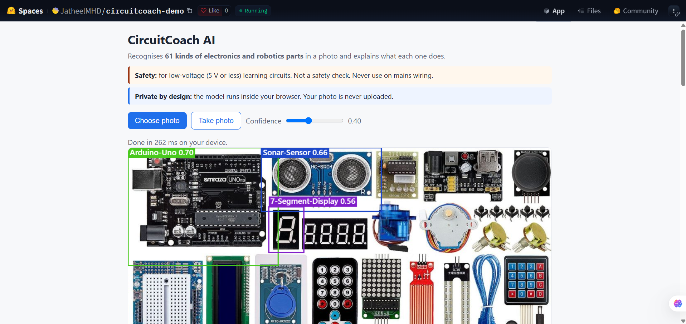
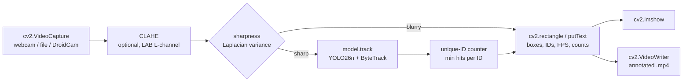
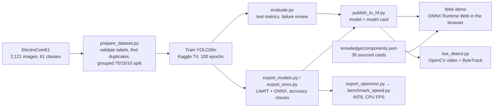

# CircuitCoach AI

**Point a camera at a box of electronics parts and learn what each one is.**
CircuitCoach AI detects **61 kinds of electronics and robotics components** (Arduino boards,
sensors, modules, passive parts, switches, displays…) in a photo and explains each one with
a short, sourced knowledge card.

**[Live demo](https://huggingface.co/spaces/JatheelMHD/circuitcoach-demo)** (runs in your browser, on laptop or phone) ·
**[Model on Hugging Face](https://huggingface.co/JatheelMHD/circuitcoach-yolo26n)** ·
Licence: AGPL-3.0



> **Safety:** for low-voltage (5 V or less) learning circuits. Not a safety check. Never use
> on mains wiring. The app names parts; it does not check whether a circuit is correct or safe.

---

## Results

YOLO26n (2.4 M parameters) fine-tuned on a cleaned, leakage-safe re-split of ElectroCom61.
Test split: **230 images, 1,294 boxes**, never used for training or model selection.

| Metric | Test split |
|---|---|
| **mAP50** | **0.958** |
| **mAP50-95** | **0.649** |
| Precision | 0.926 |
| Recall | 0.940 |
| Inference (NVIDIA T4, PyTorch) | 5.2 ms / image |

At confidence 0.25, **1,208 of 1,294 parts (93 %)** were found with the correct name;
14 got the wrong class, 72 were missed and 97 extra boxes were drawn.

> These are **in-lab** numbers: the test images come from the same lab as the training
> images. Accuracy on other desks and lighting has not been measured yet (see Roadmap).

### Failure analysis

1. **Classification is reliable** — only 14 of 1,294 test boxes received the wrong class, and
   no pair of classes was confused more than once. Most errors are missed parts or extra boxes.
2. **Small look-alike parts are hardest** — small dark round parts (buzzer, push switch,
   inductor) and two-lead parts (Zener diode, diode, resistor, small capacitors).
   Zener diode is the weakest class (mAP50 0.73); BJT transistors are often missed (recall 0.59).
3. **Background objects** — in photos with a room or floor behind the parts, the model can draw
   low-confidence boxes on furniture or people, because the dataset has no component-free images.
4. **Blur and angle** — out-of-focus parts get overlapping low-confidence boxes, steeply angled
   parts are missed, and small parts have the loosest boxes (mAP50-95 0.35–0.44), partly
   because the dataset images were stretched to 640×640.
5. **Single-lab data** — all images come from one lab, so real-world accuracy will be lower.

| Weakest classes | Test boxes | P | R | mAP50 | mAP50-95 |
|---|---|---|---|---|---|
| Zener-Diode | 23 | 0.74 | 0.78 | 0.730 | 0.371 |
| Tact-Switch | 21 | 0.79 | 0.89 | 0.816 | 0.349 |
| Motor-Driver | 18 | 0.88 | 0.78 | 0.825 | 0.658 |
| Push-Switch | 26 | 0.78 | 0.81 | 0.855 | 0.437 |
| Buzzer | 26 | 0.82 | 0.81 | 0.867 | 0.498 |
| BJT-Transistor | 23 | 0.93 | 0.59 | 0.878 | 0.441 |

Full per-class results, mix-ups and the confusion matrix: [`docs/results/test_v2/`](docs/results/test_v2/).

### Exported models

| File | Format | Size | Use | Export check |
|---|---|---|---|---|
| `circuitcoach-yolo26n.pt` | PyTorch | 5.5 MB | Python, training | Reference |
| `circuitcoach-yolo26n.onnx` | ONNX, NMS embedded, output `[1, 300, 6]` | 9.9 MB | **Web demo** (ONNX Runtime Web) | 160/160 boxes identical to PyTorch at conf 0.4 |
| `circuitcoach-yolo26n.tflite` | LiteRT float32 | 9.9 MB | Reference for mobile | 160/160 boxes identical to PyTorch at conf 0.4 |
| `circuitcoach-yolo26n_w8a32.tflite` | LiteRT, int8 weights | 2.9 MB | Android (planned) | −0.07 mAP50 points vs float32 |

All four files are on the [model page](https://huggingface.co/JatheelMHD/circuitcoach-yolo26n).
The validator reports lower mAP for the exported files (e.g. ONNX 0.920 / 0.530) because the
exported post-processing drops very-low-confidence boxes that mAP counts; at working
thresholds the detections match PyTorch exactly.

---

## Live video: detection, tracking and counting (OpenCV)

<!-- Demo clip: docs/live_demo.gif (record with --save, then convert with ffmpeg) -->

[`scripts/live_detect.py`](scripts/live_detect.py) turns the model into a live video
pipeline. It reads a webcam, a video file or a phone camera (DroidCam), tracks every part with
**ByteTrack** so each one keeps a stable ID, and counts **unique parts per class**.



```bash
python scripts/live_detect.py --source 0                                # laptop webcam
python scripts/live_detect.py --source http://<phone-ip>:4747/video     # phone via DroidCam
python scripts/live_detect.py --source clip.mp4 --save outputs/demo.mp4 # annotate a video
python scripts/live_detect.py --source 0 --show-sharpness               # calibrate the blur skip
python scripts/live_detect.py --source 0 --blur-thresh 80 --clahe       # skip blurry frames, even out lighting
```

Keys: `q` quit, `p` pause, `s` snapshot. Weights are downloaded from the model page unless
`--weights` points to a local `.pt`, `.onnx` or OpenVINO folder. On exit the script prints
(and with `--save`, writes) a JSON summary of frames, skipped frames, FPS and unique counts.

- **Tracking:** `model.track(frame, persist=True, tracker="bytetrack.yaml")`. Boxes go to the
  tracker at a low confidence (0.1) so ByteTrack's second matching pass can keep a track alive
  through a weak frame. Only boxes at or above `--conf` (default 0.4) are drawn and counted.
- **Counting:** a track ID is counted once, and only after it has been seen in `--min-hits`
  (5) frames, so one-frame flickers are not counted.
- **Blur skip:** frames whose Laplacian variance (on a 640-px-wide grey copy) is below
  `--blur-thresh` are not sent to the model. The last boxes stay on screen.
- **CLAHE:** contrast-limited histogram equalisation on the lightness channel for uneven
  desk lighting. It is off by default because the model was not trained on CLAHE images.
- **Saved video:** `cv2.VideoWriter` (mp4v). For a camera, the writer's frame rate is
  measured from the processing rate, so the clip plays at real speed.

**Limits:**
- A part that leaves and re-enters the frame, or an ID switch when parts overlap, gets a new
  ID and is counted again.
- Webcam accuracy is lower than the in-lab test numbers above (see Limitations).

### CPU speed (laptop, Intel Core i7-1355U)

<!-- Fill from docs/results/speed_cpu/benchmark.md after running scripts/benchmark_speed.py -->

[`scripts/benchmark_speed.py`](scripts/benchmark_speed.py) times every format on the same
video frames on CPU (10 warm-up frames, then 200 timed frames). Every format gets the same
640×640 input. By default Ultralytics would give the `.pt` model a smaller 640×384 input on 16:9
frames, which is not a fair comparison. It checks that each
format draws the same boxes as PyTorch, and joins in the test-split mAP50 from the export
reports. The INT8 model comes from [`scripts/export_openvino.py`](scripts/export_openvino.py):
post-training quantisation of weights *and* activations, calibrated on ElectroCom61 training
images.

The w8a32 LiteRT file is not in this table as the "quantised" model. It stores int8 weights
but computes in float32, so it is 3.5× smaller but not faster on CPU: 87.7 ms vs 57.2 ms for
float32 in [`export_report.json`](docs/results/export_report.json).

---

## How it works



### 1. Data cleaning and a leakage-safe split — [`scripts/prepare_dataset.py`](scripts/prepare_dataset.py)

- Pools the original train/valid/test splits and checks every image and label line.
- Groups **exact duplicates**, **near-duplicates** (64-bit difference hash) and **copies of the
  same source photo**, then re-splits **75/15/10 by group**, stratified by class, so
  near-identical photos never sit on both sides of the train/test line.
- Result: 1,569 / 322 / 230 images, every class in every split, 17 near-duplicate pairs kept
  together. The split is deterministic — re-running gives identical results.

### 2. Training

| Setting | Value |
|---|---|
| Model | Ultralytics YOLO26n, pretrained weights |
| Image size | 640 |
| Epochs | 100 (early stopping off; best epoch chosen on validation) |
| Batch | 32 (fixed for reproducibility) |
| Augmentation | Ultralytics defaults + rotation ±10°, vertical flip |
| Seed | 0, deterministic |
| Hardware | Kaggle, NVIDIA Tesla T4 |

A first run with early stopping (patience 20) stopped at epoch 58 before the learning-rate
decay and close-mosaic phase; the full 100-epoch run improved validation precision from
0.901 to 0.935 and mAP50 from 0.949 to 0.958.

### 3. Evaluation — [`scripts/evaluate.py`](scripts/evaluate.py)

Overall and per-class metrics, confusion matrix, and a failure review at a fixed confidence
that sorts every error into *wrong class*, *missed* or *extra box*, and saves the worst images.

### 4. Export — [`scripts/export_models.py`](scripts/export_models.py), [`scripts/export_onnx.py`](scripts/export_onnx.py)

Exports LiteRT (float32, w8a32) and ONNX, re-tests each on the test split and compares boxes
one by one against PyTorch.

### 5. Web demo — [`space/`](space/)

A static page (no server) that downloads the ONNX model once and runs it **on the visitor's
device** with ONNX Runtime Web — the photo never leaves the browser.
[`detector.js`](space/detector.js) handles letterboxing, post-processing and grouping, and
is unit-tested with Node ([`tests/detector.test.js`](tests/detector.test.js)). The page then shows boxes and a knowledge card for each part type,
with a confidence slider.

### 6. Knowledge cards — [`knowledge/components.json`](knowledge/components.json)

36 cards for the most common learning-kit parts. Each card has the part's purpose, key facts,
cautions, **what the camera cannot tell** (resistor values, Zener voltage, NPN vs PNP…),
look-alike classes and sources (datasheets and official documentation). No language model is
used, because a wrong answer about wiring can damage parts.

### 7. Live video and CPU optimisation — [`scripts/live_detect.py`](scripts/live_detect.py), [`scripts/export_openvino.py`](scripts/export_openvino.py), [`scripts/benchmark_speed.py`](scripts/benchmark_speed.py)

An OpenCV video loop with ByteTrack tracking and unique-part counts, an OpenVINO FP32/INT8
export with an accuracy check, and a CPU speed benchmark. See
[Live video](#live-video-detection-tracking-and-counting-opencv). The helpers are unit-tested
with pytest ([`tests/test_live_detect.py`](tests/test_live_detect.py)).

---

## Repository structure

```
scripts/      prepare_dataset.py, evaluate.py, export_models.py, export_onnx.py, publish_to_hf.py,
              live_detect.py, export_openvino.py, benchmark_speed.py
notebooks/    Kaggle training and evaluation notebooks
knowledge/    components.json — knowledge cards
space/        in-browser web demo (index.html, detector.js, components.json)
tests/        node tests/detector.test.js (web demo) · pytest tests/test_live_detect.py (video helpers)
docs/         class list, dataset audit, training curves, test results, export reports
```

## Reproduce

Everything runs on a free Kaggle GPU notebook with
[ElectroCom61](https://www.kaggle.com/datasets/faiyazabdullah/electrocom61) attached.

```bash
pip install ultralytics==8.4.215 huggingface_hub
python scripts/prepare_dataset.py --raw <ElectroCom-61_v2 folder> --out ec61_clean
yolo train model=yolo26n.pt data=ec61_clean/data.yaml imgsz=640 epochs=100 patience=0 batch=32 \
     degrees=10 flipud=0.5 seed=0 deterministic=True
python scripts/evaluate.py --weights runs/detect/train/weights/best.pt --data ec61_clean/data.yaml --split test --out eval/test
python scripts/export_models.py --weights runs/detect/train/weights/best.pt --data ec61_clean/data.yaml --out release
python scripts/export_onnx.py --weights runs/detect/train/weights/best.pt --data ec61_clean/data.yaml --out onnx
pip install openvino
python scripts/export_openvino.py --weights runs/detect/train/weights/best.pt --data ec61_clean/data.yaml --out openvino
python scripts/make_test_video.py --images ec61_clean/test/images --out test_clip.mp4   # held-out test images -> video
```

Live video and the CPU benchmark run on a laptop:

```bash
pip install ultralytics==8.4.215 huggingface_hub lap openvino pytest
python scripts/live_detect.py --source 0
python scripts/benchmark_speed.py --video clip.mp4 --weights circuitcoach-yolo26n.pt circuitcoach-yolo26n.onnx \
    circuitcoach-yolo26n_openvino_model circuitcoach-yolo26n_int8_openvino_model \
    --accuracy docs/results/export_report.json docs/results/onnx_report.json docs/results/openvino_report.json
pytest tests/test_live_detect.py
```

## Limitations

- Trained on photos from a single lab; accuracy drops on unfamiliar backgrounds and lighting.
- Cannot read component values (resistor bands, capacitor ratings) or exact model numbers,
  and cannot tell genuine boards from clones.
- Look-alike parts (diode vs Zener diode, push vs tact switch, small capacitors) can be confused.
- Does not trace wires or verify circuits — by design.

## Roadmap

- [ ] **Phone test set** — 50–100 photos of real parts on ordinary desks, to measure real-world accuracy
- [ ] **Android app** — offline, on-device detection with the 2.9 MB w8a32 model
- [x] **Live video** — OpenCV pipeline with ByteTrack tracking and unique-part counts
- [ ] CPU speed table (PyTorch / ONNX / OpenVINO FP32 / INT8) and a demo clip
- [ ] Knowledge cards for the remaining 25 classes
- [ ] Parts checklist for fixed practicals (e.g. "LED blink": are all the parts here?)

## Credits and licence

- **Dataset:** ElectroCom61 by Sayeedi et al., CC BY 4.0, used with the cleaning and re-split
  described above. The dataset is not redistributed here.
  Original data: https://data.mendeley.com/datasets/6scy6h8sjz/2
- **Model weights and code:** AGPL-3.0 (models trained with Ultralytics code fall under AGPL-3.0).

```bibtex
@article{sayeedi2025electrocom61,
  title   = {ElectroCom61: A multiclass dataset for detection of electronic components},
  author  = {Sayeedi, Md. Faiyaz Abdullah and Osmani, Anas Mohammad Ishfaqul Muktadir and
             Rahman, Taimur and Deepti, Jannatul Ferdous and Rahman, Raiyan and Islam, Salekul},
  journal = {Data in Brief},
  volume  = {59},
  pages   = {111331},
  year    = {2025},
  doi     = {10.1016/j.dib.2025.111331}
}
```
